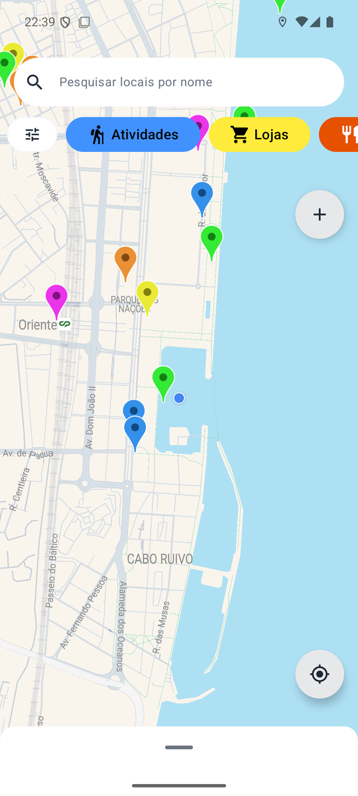
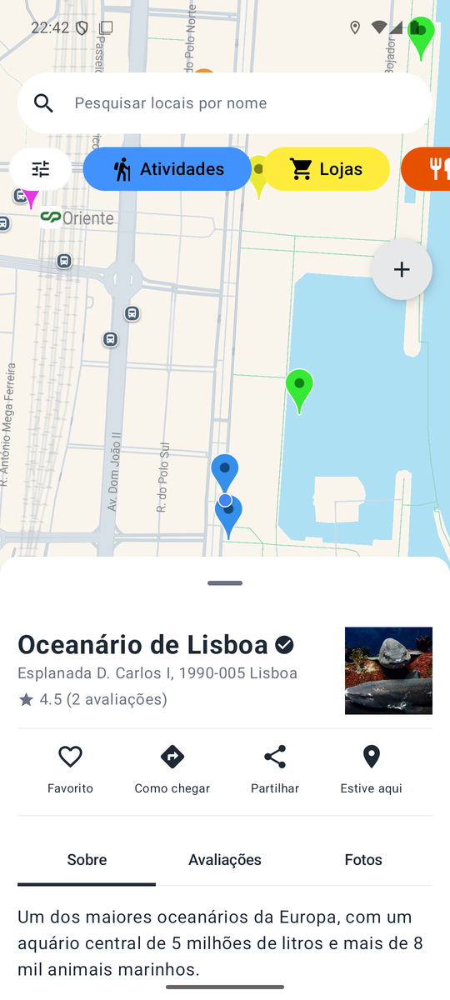
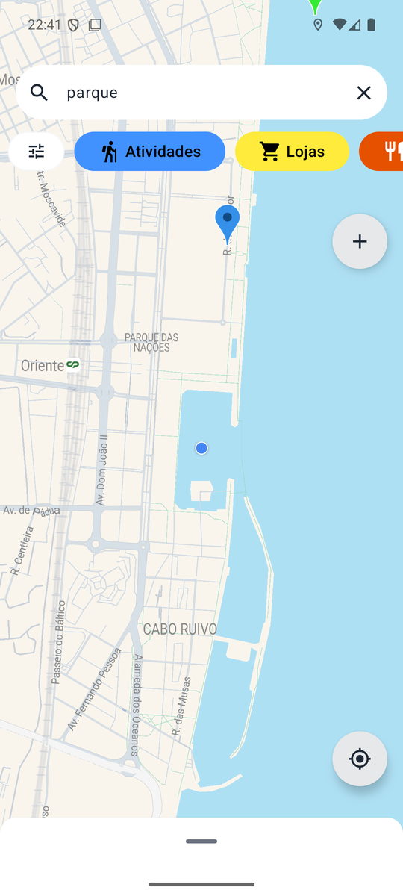
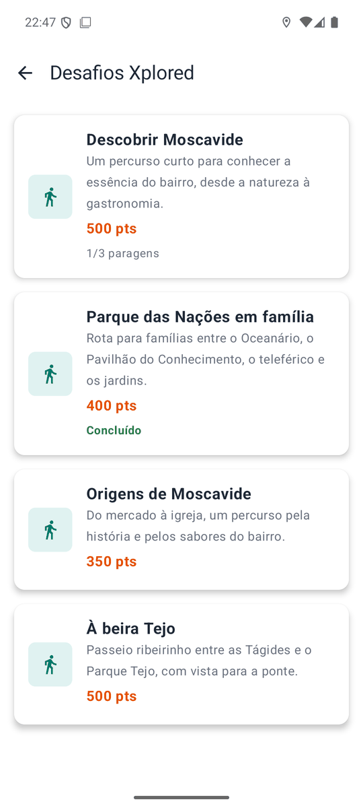
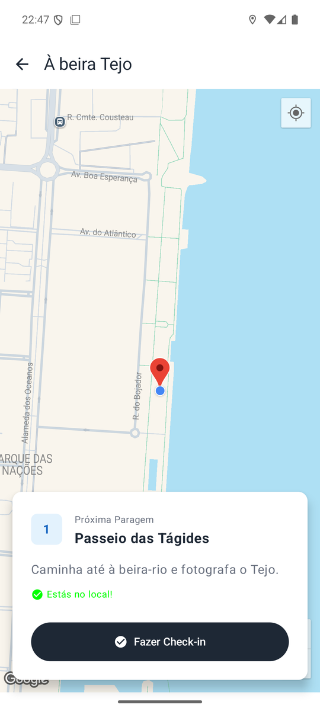
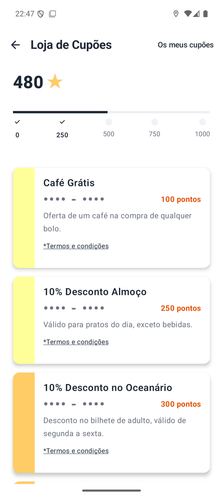
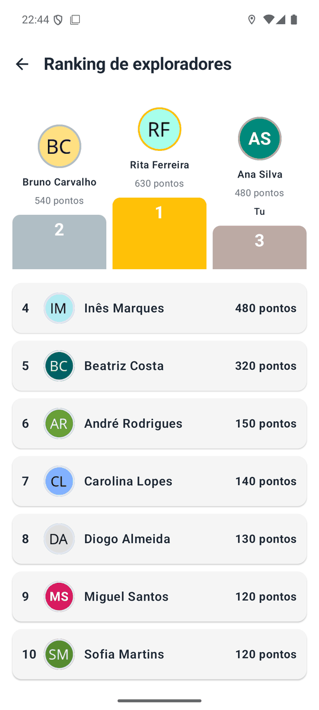
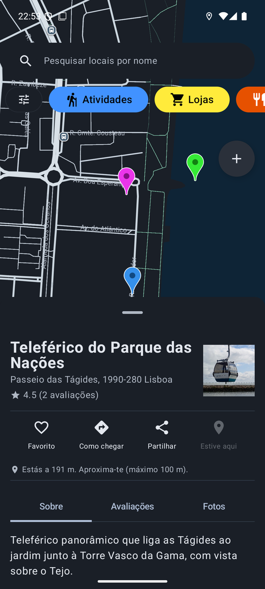

<h1 align="center">Xplored</h1>

<p align="center">
  Interactive map app that rewards people for exploring their city and supporting local businesses.
</p>

<p align="center">
  
  
  
  
  
  
  
  
  
  
</p>

Xplored shows places of interest on a map, grouped by category, and lets users review them, add
new ones and check in when they are physically there. Check-ins and route games (pedipapers) earn
points, and points are redeemed for coupons offered by local businesses. The seed data covers
Moscavide and Parque das Nações, in Lisbon.

Course project of "Projeto de Desenvolvimento Móvel" (mobile development project), 3rd semester
of the BSc in Computer Engineering at IADE, Universidade Europeia, academic year 2025/26
(group t1-g01).

## Status

Completed coursework, delivered in three phases. The original reports, mockups and
presentations are kept in `Documents/`, in Portuguese.

| Delivery | Date | Scope |
|---|---|---|
| First delivery and pitch | 8 October 2025 | Report, mockups, project charter, WBS, Gantt chart, poster, video |
| Second delivery | 12 November 2025 | Database, Spring Boot backend, first Android version |
| Final delivery | 14 December 2025 | Complete app, final report, user manual, REST documentation |

## Screenshots

<table>
  <tr>
    <td align="center"><br>Map</td>
    <td align="center"><br>Place detail</td>
    <td align="center"><br>Search</td>
    <td align="center"><br>Pedipapers</td>
  </tr>
  <tr>
    <td align="center"><br>Route game</td>
    <td align="center"><br>Coupons</td>
    <td align="center"><br>Leaderboard</td>
    <td align="center"><br>Dark mode</td>
  </tr>
</table>

Every screen, with captions, is in [docs/FEATURES.md](docs/FEATURES.md), together with the
original Figma mockups.

## Features

| Area | What the app does |
|---|---|
| Map | Google Map with places in five categories, each with its own colour; list of nearby places; category filter; distance filter from 1 km to 50 km (50 km shows every place) |
| Search | Search by place name, ignoring case and accents |
| Places | Detail screen with about, reviews and photos; add a place with a category and photos; places added by a USER wait for moderation |
| Reviews | Rating from 1 to 5, title, comment and photos; "useful" and "not useful" reactions; the place average is recalculated on every review |
| Favourites | Save places and list them in one screen |
| Navigation and sharing | "Como chegar" opens Google Maps navigation to the place; a place can be shared with other apps |
| Check-in | "Estive aqui" at a place, validated by GPS within 100 m, +10 points once per place |
| Pedipapers | Four themed routes with several stops each. Every stop is checked in by GPS within 50 m, some stops require a photo as evidence, and the server pays the points only when all stops are done |
| Points and coupons | Redeem points for coupons from three local businesses; the coupon code is revealed only after redemption; history of points and of redeemed coupons |
| Leaderboard | Top 10 explorers by points plus the position of the signed-in user |
| Account | Register, sign in, edit profile and avatar; password reset with a 6 digit code |
| Moderation | An ADMIN approves or rejects places submitted by users |
| Appearance | Light, dark or system theme, chosen in Settings |

The user interface is in European Portuguese.

## Architecture in brief

A native Android client talks to a Spring Boot REST API over HTTP, and the API stores data in
MySQL. Uploaded photos are written to the `uploads/` folder of the backend and served from
`/uploads/**`. Full description and diagrams in [docs/ARCHITECTURE.md](docs/ARCHITECTURE.md).

| Concern | Design |
|---|---|
| Client | Kotlin, one Activity per screen, Compose UI, Retrofit services in `network/`, a small repository layer for places and photos |
| API | Spring Boot 3.5.7 on port 9000, 14 controllers, JPA repositories for simple entities and `JdbcTemplate` for queries and writes with business rules |
| Database | MySQL 8, database `xplored_db`, 17 tables, schema in `data_base/create.sql` |
| Points | Every change to a user balance writes a row to `points_ledger` |
| Validation | Check-in distance (100 m for places, 50 m for pedipaper stops), coupon balance and photo ownership are checked on the server, not in the app |
| Passwords | Stored as BCrypt hashes, never returned by the API |

## Technology stack

| Layer | Technologies |
|---|---|
| Android app | Kotlin 2.0.21, Jetpack Compose (Material 3), Retrofit 2.9 with Gson, OkHttp logging, Coil, Google Maps Compose 4.3.3, Play Services Location, Android Gradle Plugin 8.13; minSdk 31, targetSdk 36 |
| Backend | Java 21, Spring Boot 3.5.7 (web, data JPA), Spring Security Core (BCrypt only), Gradle |
| Database | MySQL 8.4 |
| External services | Google Maps SDK for Android; photos in the seed data are hotlinked from Wikimedia Commons |

## Documentation

| Document | Contents |
|---|---|
| [Setup](docs/SETUP.md) | Run the database, backend and app on Windows, macOS or Linux; test logins; reset codes |
| [API](docs/API.md) | Every REST endpoint with parameters, bodies and status codes |
| [Architecture](docs/ARCHITECTURE.md) | Components, diagram, main flows, known limitations |
| [Data model](docs/DATA_MODEL.md) | Tables, relationships, ER diagram, points ledger rules |
| [Features](docs/FEATURES.md) | Screenshots with captions and the original mockups |
| [Final report](Documents/3%C2%AAEntrega/Relat%C3%B3rio%20-%203%C2%AA%20Entrega.md) | Portuguese: problem, objectives, target audience, task distribution |
| [User manual](Documents/3%C2%AAEntrega/Manual/Manual%20do%20utilizador.md) | Portuguese, written for the final delivery |
| [REST documentation, final delivery](Documents/3%C2%AAEntrega/REST/REST.md) | Portuguese, written for the final delivery; [docs/API.md](docs/API.md) is the current reference |

## Repository layout

```text
Xplored/
├── back_end/                     Spring Boot API (Java 21, Gradle)
│   └── src/main/java/com/Xplored/Xplored/
│       ├── Controller/           REST controllers, one per area
│       ├── Model/                JPA entities, repositories, request and response classes
│       └── Config/               static serving of /uploads and absolute photo URLs
├── front_end/                    Android app (Kotlin, Jetpack Compose); Gradle root
│   └── app/src/main/java/pt/iade/ei/xplored/
│       ├── ui/screens/           one package per area: main, place, reviews, pedipaper, ...
│       ├── ui/theme/             colours, typography and theme preference
│       ├── network/              Retrofit services and request classes
│       ├── repositories/         place and photo repositories
│       └── data/models/          app-side models
├── data_base/
│   ├── create.sql                schema and category seed
│   ├── populate.sql              test data
│   └── queries.sql               example queries
├── docs/                         technical documentation and screenshots
├── Documents/                    academic archive of the three deliveries, in Portuguese
│   ├── 1ªEntrega/                report, mockups, charts, poster, video, slides
│   ├── 2ªEntrega/                report, database diagram, charts, slides
│   └── 3ªEntrega/                report, user manual, REST documentation, slides, video
├── LICENSE
└── README.md
```

The `Documents/` folder is the material handed in during the course and stays in Portuguese, as
submitted.

## Known limitations

- The API has no token authentication. Endpoints trust the email sent by the app, so any client
  can act as any user. This was accepted for the scope of the coursework.
- There is no mail service. Password reset codes are written to the server log.
- Seed photos are hotlinked from Wikimedia Commons; the licence and author of each image are on
  its Commons file page.
- The backend tests need a running MySQL and are not run by the build.

More in [docs/ARCHITECTURE.md](docs/ARCHITECTURE.md#known-limitations).

## Team

<table>
  <tr>
    <td align="center" valign="top" width="25%">
      <a href="https://github.com/Cabacadosinformaticos"></a><br>
      <b>Tiago Cabaça</b><br>
      <sub>20241185</sub><br>
      <sub>Reports, mockups, design and database</sub><br>
      <a href="https://github.com/Cabacadosinformaticos">@Cabacadosinformaticos</a>
    </td>
    <td align="center" valign="top" width="25%">
      <a href="https://github.com/cesarelder"></a><br>
      <b>César Rodrigues</b><br>
      <sub>20240449</sub><br>
      <sub>Android app and presentations</sub><br>
      <a href="https://github.com/cesarelder">@cesarelder</a>
    </td>
    <td align="center" valign="top" width="25%">
      <a href="https://github.com/oastghost"></a><br>
      <b>Muhammad Sacoor</b><br>
      <sub>20241707</sub><br>
      <sub>Spring Boot server, Android app, poster and video</sub><br>
      <a href="https://github.com/oastghost">@oastghost</a>
    </td>
    <td align="center" valign="top" width="25%">
      <a href="mailto:20241526@iade.pt"></a><br>
      <b>Lucas Nicolau</b><br>
      <sub>20241526</sub><br>
      <sub>Spring Boot server support</sub><br>
      <sub>no GitHub profile</sub>
    </td>
  </tr>
</table>

Full names: Tiago Manuel Antunes Cabaça, César de Oliveira Rodrigues, Muhammad Sudeis Abdul Latif
Sacoor and Lucas Dernedde Sequeira Gomes Nicolau. The split of the work is in the
[final report](Documents/3%C2%AAEntrega/Relat%C3%B3rio%20-%203%C2%AA%20Entrega.md), section 2.

BSc in Computer Engineering (Licenciatura em Engenharia Informática)\
IADE, Universidade Europeia

## License

Xplored is open source under the [MIT License](LICENSE). You may use, copy, modify and
distribute the code and the documentation, also in other projects, as long as the copyright
notice and the license text are kept.

Copyright (c) 2025 Tiago Manuel Antunes Cabaça, César de Oliveira Rodrigues, Lucas Dernedde
Sequeira Gomes Nicolau and Muhammad Sudeis Abdul Latif Sacoor.

Third-party software, libraries, fonts and images keep their own licenses. The seed photos are
hotlinked from Wikimedia Commons; the license and author of each image are on its file page.
