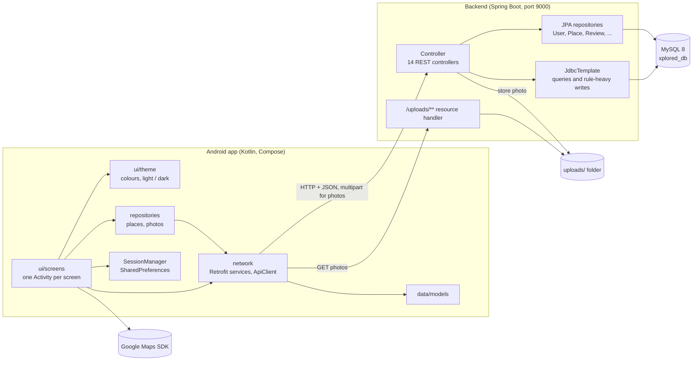
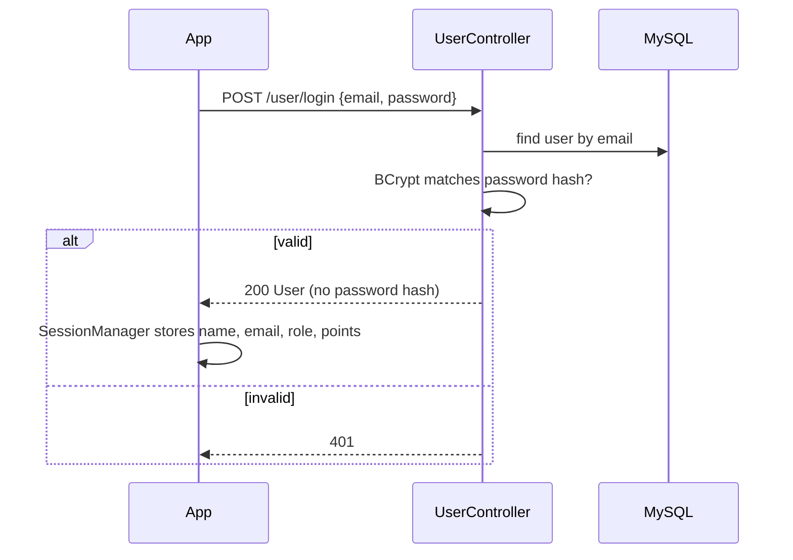
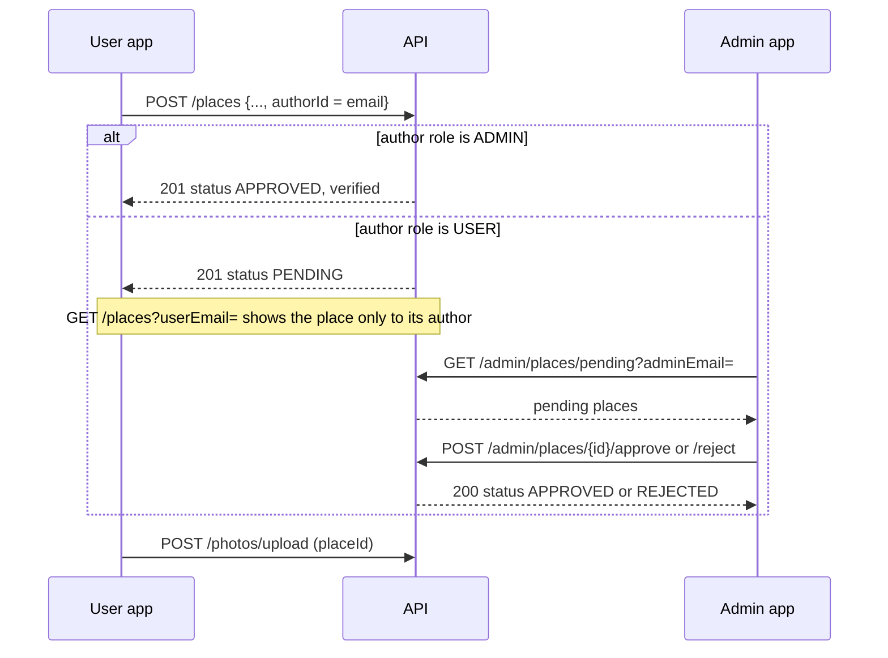
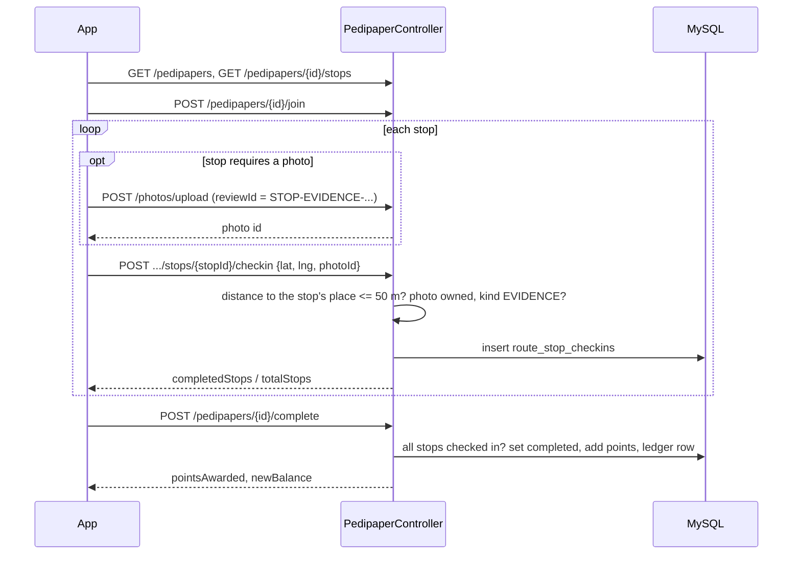

# Architecture

Xplored has three parts: a native Android app, a Spring Boot REST API and a MySQL database. The
app is the only client of the API. There is no web front end and no other service besides the
Google Maps SDK inside the app.

## Components

### Android app

Package `pt.iade.ei.xplored`, module `app` in the Gradle root `front_end/`.

| Layer | Location | Role |
|---|---|---|
| Screens | `ui/screens/<area>/` | One `ComponentActivity` per screen, with the UI written in Jetpack Compose. Areas: `main` (map), `place`, `reviews`, `pedipaper`, `coupon`, `history`, `leaderboard`, `favorites`, `profile`, `settings`, `auth`, `admin`, `misc` |
| Theme | `ui/theme/` | Colour schemes, typography and `ThemePreferences` (system, light or dark). The map has a dark style in `res/raw/map_style_dark.json` |
| Network | `network/` | `ApiClient` builds one Retrofit instance (Gson, 30 s timeouts, body logging in debug builds). One `*ApiService` interface per area, plus request classes. `PhotoUploadClient` sends the multipart uploads |
| Repositories | `repositories/` | `PlaceRepository` and `PhotoRepository` wrap the calls that several screens share |
| Models | `data/models/` | Classes the app deserialises into, grouped by area |
| Session | `SessionManager.kt` | Signed-in state and the user data (name, email, role, points) in `SharedPreferences`. Accounts live on the server; there is no local user list |

The base URL comes from `BuildConfig.API_BASE_URL`, filled by the Secrets Gradle Plugin from
`local.properties` or `local.defaults.properties`. The Maps key is injected into the manifest the
same way (`MAPS_API_KEY`). See [SETUP.md](SETUP.md).

### Backend

Package `com.Xplored.Xplored`.

| Part | Location | Role |
|---|---|---|
| Controllers | `Controller/` | `AdminController`, `CategoryController`, `CouponController`, `FavoriteController`, `LeaderboardController`, `PasswordResetController`, `PedipaperController`, `PhotoController`, `PlaceController`, `PointsController`, `ReactionController`, `ReviewController`, `UserController`, `VisitController` |
| Model | `Model/` | JPA entities and Spring Data repositories for users, categories, reviews, reactions, photos and the pedipaper tables, plus request and response classes |
| Config | `Config/` | `WebConfig` serves `/uploads/**` from the `uploads/` folder; `UrlUtil` converts stored relative paths into absolute URLs |

Two data access styles are mixed. Simple entity access (users, reviews, reactions, photos,
pedipaper participation) uses JPA repositories. Queries with joins and writes that must be atomic
and carry business rules (places, favourites, visits, coupons, ledger, password reset, moderation,
leaderboard) use `JdbcTemplate` with SQL written in the controller. Multi-step writes are
`@Transactional`.

Dependencies are `spring-boot-starter-web`, `spring-boot-starter-data-jpa`, the MySQL driver and
`spring-security-core`, used only for `BCryptPasswordEncoder`. Spring Security itself is not
configured, so there are no filters, sessions or tokens.

Uploaded photos are written to `uploads/<uuid>.<ext>` in the working directory of the backend.
The database keeps the relative path, and responses turn it into an absolute URL from the
incoming request, so the same data works for the emulator (`10.0.2.2`) and for a LAN address.

### Database

MySQL 8 with 17 tables. See [DATA_MODEL.md](DATA_MODEL.md).

## Main flows

### Login

The app keeps the email. Later requests carry it as a parameter or in the body; the server never
issues a token (see [Known limitations](#known-limitations)).

### Password reset

1. The user enters an email. The app calls `POST /user/password-reset/request`.
2. The server answers 200 whether or not the account exists. If it exists, it invalidates older
   unused codes, stores the BCrypt hash of a new 6 digit code that expires in 15 minutes, and
   writes the code to the server log.
3. The user types the code. The app asks for the new password twice and calls
   `POST /user/password-reset/confirm` with email, code and password.
4. The server checks the newest valid code. A wrong code adds 1 to `attempts`; at 5 attempts the
   code is refused. A correct code replaces the password hash and marks the code as used.

### Place creation and moderation

Photos of the new place are uploaded after the place exists, because the upload needs its id.
Approved places appear for everyone; rejected places never appear in the lists.

### GPS check-in at a place

The app reads the device location and calls `POST /visits`. The server computes the haversine
distance to the place and refuses anything beyond 100 m. The first valid check-in per user and
place inserts a `visits` row, adds 10 points and writes a ledger row. A repeat answers 200 with
`pointsAwarded: 0`.

### Pedipaper check-in and completion

`GET /pedipapers/{id}/progress` lets the game resume at the first stop without a check-in. The
route pays out only once.

### Coupon redemption

`POST /coupons/redeem` runs in one transaction: load the user and the coupon, refuse inactive
coupons and insufficient balances, debit with a guarded `UPDATE`, insert the `redemptions` row and
a negative ledger row, and return the coupon code. The list endpoint `GET /coupons/active` never
returns codes, so a code is visible only after paying for it and in the user's redemption history.

### Points ledger

All three sources of points (visit, pedipaper, coupon) change `users.points` and insert a
`points_ledger` row in the same transaction. `GET /user/points-history` reads the ledger newest
first. The amounts and reason texts are listed in
[DATA_MODEL.md](DATA_MODEL.md#points-ledger).

## Known limitations

- **No authentication or authorisation.** Login returns the user, but no token is issued, and
  endpoints trust the email in the request. Anyone who knows an email can act as that user,
  including as an ADMIN on `/admin/**`. Cleartext HTTP is allowed for local hosts only
  (`network_security_config.xml`).
- **Reset codes are only in the log.** There is no mail or SMS service, by design for the
  coursework.
- **Location is trusted.** The server checks the distance between the coordinates it receives and
  the place, but cannot tell whether those coordinates are real, so GPS spoofing works.
- **Photos on local disk.** Uploads live in the `uploads/` folder of one machine. They are not
  scanned, resized or removed when the row that points to them is deleted.
- **Seed photos are external.** Place photos in `populate.sql` are Wikimedia Commons URLs, and the
  evidence rows point to files that do not exist in a fresh checkout.
- **Moderation covers places only.** Reviews and photos are published without review.
- **Single instance.** No caching, pagination or rate limiting; list endpoints return every row.
- **Tests.** `XploredApplicationTests` needs a live MySQL; there are no unit tests of the rules
  above.
