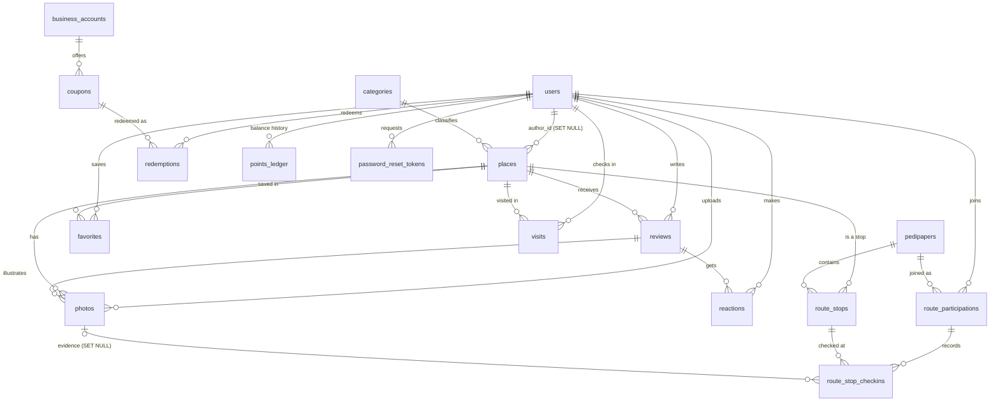

# Data model

The database is MySQL 8, schema `xplored_db`, created by
[`data_base/create.sql`](../data_base/create.sql) with `utf8mb4` and the collation
`utf8mb4_general_ci`. It has 17 tables. Hibernate does not manage the schema
(`spring.jpa.hibernate.ddl-auto=none`): the SQL script is the only source of the structure.

## Entity relationship diagram

Column lists are in the tables below. Unless stated otherwise, deleting a parent row deletes its
children (`ON DELETE CASCADE`).

## Conventions

- Primary keys are declared `SERIAL`, which in MySQL is `BIGINT UNSIGNED NOT NULL AUTO_INCREMENT
  UNIQUE`. Foreign key columns are `BIGINT UNSIGNED`.
- Photo paths and profile photo values are stored as relative paths (`/uploads/<uuid>.<ext>`) or
  as full `http` URLs. The API turns relative paths into absolute URLs.
- Coordinates are `DECIMAL(9,6)`, which is about 0.1 m of resolution.
- Moderation and role values are plain strings, not database enums.

## Tables

### users

| Column | Type | Notes |
|---|---|---|
| `id` | SERIAL | Primary key |
| `name` | VARCHAR(120) | Required |
| `email` | VARCHAR(120) | Required, unique; the identity used by the API |
| `password_hash` | VARCHAR(255) | Required; BCrypt |
| `about` | TEXT | |
| `country` | VARCHAR(80) | |
| `role` | VARCHAR(20) | Default `USER`. Values used: `USER`, `ADMIN`, `BUSINESS` |
| `profile_photo` | VARCHAR(500) | |
| `points` | INT | Default 0; current balance |
| `created_at` | TIMESTAMP | Default current time |

### categories

| Column | Type | Notes |
|---|---|---|
| `id` | SERIAL | Primary key |
| `name` | VARCHAR(80) | Required, unique |
| `color_hex` | VARCHAR(20) | Marker colour on the map |
| `icon_name` | VARCHAR(50) | |

`create.sql` inserts five rows: 1 Atividades `#4192FF`, 2 Lojas `#FFEB3B`, 3 Restauração `#E65100`,
4 Históricos `#880E4F`, 5 Paisagens `#3D6E44`.

### places

| Column | Type | Notes |
|---|---|---|
| `id` | SERIAL | Primary key |
| `name` | VARCHAR(120) | Required |
| `description` | TEXT | |
| `lat`, `lng` | DECIMAL(9,6) | Required |
| `address_full` | VARCHAR(255) | |
| `category_id` | BIGINT UNSIGNED | Required, FK to `categories` (no cascade) |
| `author_id` | BIGINT UNSIGNED | FK to `users`, `ON DELETE SET NULL` |
| `avg_rating` | DECIMAL(3,2) | Default 0.0; recalculated by the API after each review |
| `is_verified` | BOOLEAN | Default false; true for approved places |
| `status` | VARCHAR(20) | Required, default `APPROVED`. `PENDING`, `APPROVED` or `REJECTED` |
| `created_at` | TIMESTAMP | |

### reviews

| Column | Type | Notes |
|---|---|---|
| `id` | SERIAL | Primary key |
| `rating` | INT | Required, `CHECK (rating BETWEEN 1 AND 5)` |
| `title` | VARCHAR(100) | |
| `comment` | TEXT | |
| `user_id` | BIGINT UNSIGNED | Required, FK to `users` |
| `place_id` | BIGINT UNSIGNED | Required, FK to `places` |
| `created_at` | TIMESTAMP | |

### photos

| Column | Type | Notes |
|---|---|---|
| `id` | SERIAL | Primary key |
| `url` | VARCHAR(500) | Required |
| `place_id` | BIGINT UNSIGNED | FK to `places`, cascade |
| `user_id` | BIGINT UNSIGNED | FK to `users`, `ON DELETE SET NULL` |
| `review_id` | BIGINT UNSIGNED | FK to `reviews`, cascade |
| `kind` | VARCHAR(20) | Default `GALLERY`. `EVIDENCE` marks pedipaper check-in photos |
| `status` | VARCHAR(20) | Default `APPROVED` |
| `created_at` | TIMESTAMP | |

Gallery photos appear in place and profile galleries. The cover of a place is its gallery photo
with the lowest id. Evidence photos are never listed in galleries.

### reactions

| Column | Type | Notes |
|---|---|---|
| `id` | SERIAL | Primary key |
| `type` | VARCHAR(20) | Required. `USEFUL` or `NOT_USEFUL` |
| `user_id` | BIGINT UNSIGNED | Required, FK to `users` |
| `review_id` | BIGINT UNSIGNED | Required, FK to `reviews` |

`UNIQUE (user_id, review_id)`: one reaction per user and review.

### pedipapers

| Column | Type | Notes |
|---|---|---|
| `id` | SERIAL | Primary key |
| `name` | VARCHAR(120) | Required |
| `description` | TEXT | |
| `total_points` | INT | Default 0; points paid on completion |
| `active` | BOOLEAN | Default true; only active routes are listed |
| `created_at` | TIMESTAMP | |

### route_stops

| Column | Type | Notes |
|---|---|---|
| `id` | SERIAL | Primary key |
| `pedipaper_id` | BIGINT UNSIGNED | Required, FK to `pedipapers`, cascade |
| `place_id` | BIGINT UNSIGNED | Required, FK to `places`, cascade |
| `stop_order` | INT | Required; position in the route |
| `task_description` | TEXT | What the player must do |
| `requires_photo` | BOOLEAN | Default false |

### route_participations

| Column | Type | Notes |
|---|---|---|
| `id` | SERIAL | Primary key |
| `user_id` | BIGINT UNSIGNED | Required, FK to `users` |
| `pedipaper_id` | BIGINT UNSIGNED | Required, FK to `pedipapers` |
| `completed` | BOOLEAN | Default false |
| `points_awarded` | INT | Default 0 |
| `started_at` | TIMESTAMP | |
| `completed_at` | TIMESTAMP | Null until completed |

`UNIQUE (user_id, pedipaper_id)`: a user joins a route once.

### route_stop_checkins

| Column | Type | Notes |
|---|---|---|
| `id` | SERIAL | Primary key |
| `participation_id` | BIGINT UNSIGNED | Required, FK to `route_participations`, cascade |
| `route_stop_id` | BIGINT UNSIGNED | Required, FK to `route_stops`, cascade |
| `lat`, `lng` | DECIMAL(9,6) | Position sent by the app, validated within 50 m |
| `photo_id` | BIGINT UNSIGNED | Null, FK to `photos`, `ON DELETE SET NULL` |
| `created_at` | TIMESTAMP | |

`UNIQUE (participation_id, route_stop_id)`: one check-in per stop.

### business_accounts

| Column | Type | Notes |
|---|---|---|
| `id` | SERIAL | Primary key |
| `name` | VARCHAR(120) | Required |
| `email` | VARCHAR(120) | Unique |
| `created_at` | TIMESTAMP | |

### coupons

| Column | Type | Notes |
|---|---|---|
| `id` | SERIAL | Primary key |
| `title` | VARCHAR(120) | Required |
| `description` | TEXT | |
| `cost_points` | INT | Required |
| `business_account_id` | BIGINT UNSIGNED | Required, FK to `business_accounts`, cascade |
| `active` | BOOLEAN | Default true |
| `code` | VARCHAR(50) | The redeem code shown to the user after redemption |

### redemptions

| Column | Type | Notes |
|---|---|---|
| `id` | SERIAL | Primary key |
| `user_id` | BIGINT UNSIGNED | Required, FK to `users` |
| `coupon_id` | BIGINT UNSIGNED | Required, FK to `coupons` |
| `redeemed_at` | TIMESTAMP | |

A user can redeem the same coupon more than once; there is no unique constraint.

### points_ledger

| Column | Type | Notes |
|---|---|---|
| `id` | SERIAL | Primary key |
| `user_id` | BIGINT UNSIGNED | Required, FK to `users` |
| `amount` | INT | Required; positive when points are earned, negative when spent |
| `reason` | VARCHAR(255) | Human readable text in European Portuguese |
| `created_at` | TIMESTAMP | |

### password_reset_tokens

| Column | Type | Notes |
|---|---|---|
| `id` | SERIAL | Primary key |
| `user_id` | BIGINT UNSIGNED | Required, FK to `users` |
| `code_hash` | VARCHAR(255) | Required; BCrypt hash of the 6 digit code, never the code |
| `expires_at` | TIMESTAMP | Required; creation time plus 15 minutes |
| `attempts` | INT | Default 0; wrong codes tried |
| `used` | BOOLEAN | Default false; set when the code is used or replaced |
| `created_at` | TIMESTAMP | |

### favorites

| Column | Type | Notes |
|---|---|---|
| `user_id` | BIGINT UNSIGNED | FK to `users`, cascade |
| `place_id` | BIGINT UNSIGNED | FK to `places`, cascade |
| `created_at` | TIMESTAMP | |

Primary key `(user_id, place_id)`.

### visits

| Column | Type | Notes |
|---|---|---|
| `id` | SERIAL | Primary key |
| `user_id` | BIGINT UNSIGNED | Required, FK to `users`, cascade |
| `place_id` | BIGINT UNSIGNED | Required, FK to `places`, cascade |
| `lat`, `lng` | DECIMAL(9,6) | Position of the check-in, validated within 100 m |
| `created_at` | TIMESTAMP | |

`UNIQUE (user_id, place_id)`: one visit per user and place.

## Points ledger

`users.points` is the balance. `points_ledger` records each movement with a signed amount and a
reason, so the history screen can show where points came from.

| Source | Amount | `reason` text | Endpoint |
|---|---|---|---|
| GPS check-in at a place (first time only) | +10 | `Visita: <place name>` | `POST /visits` |
| Pedipaper completed (once per route) | `pedipapers.total_points` | `Pedipaper concluído: <pedipaper name>` | `POST /pedipapers/{id}/complete` |
| Coupon redeemed | `-coupons.cost_points` | `Cupão resgatado: <coupon title>` | `POST /coupons/redeem` |

Rules:

- The balance update and the ledger insert run in the same database transaction.
- A coupon is debited with `UPDATE users SET points = points - ? WHERE id = ? AND points >= ?`, so
  two simultaneous redemptions cannot take the balance below zero.
- Repeating a visit check-in or a pedipaper completion changes nothing and adds no ledger row.
- Reviews, photos and other actions do not award points.
- The seed script sets the balances of the test users directly and adds some historical ledger rows, so for seed users the balance is not guaranteed to equal the ledger sum.
- The leaderboard ranks `users.points`, not the ledger sum.
