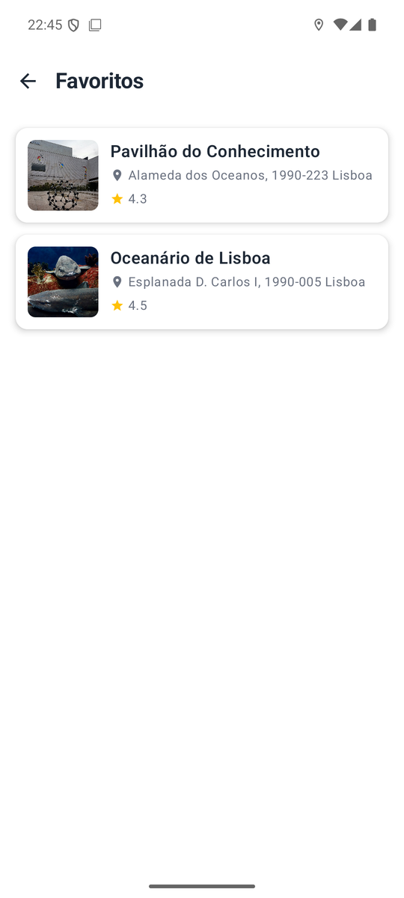
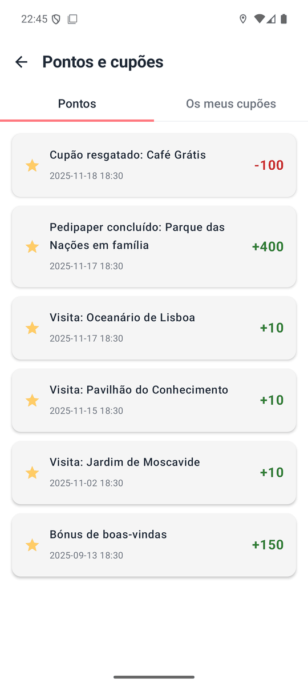
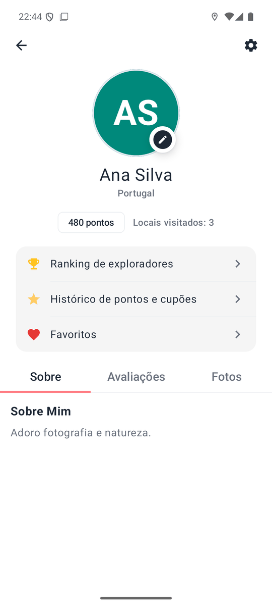
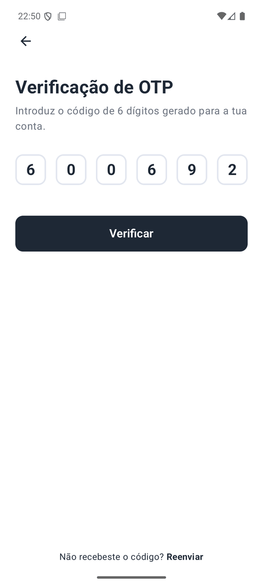
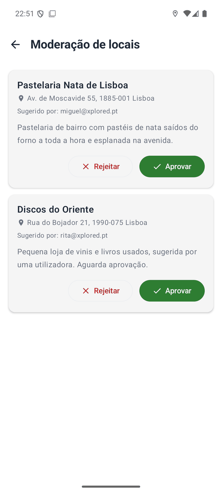

# Features

Screens of the app, running on an Android emulator against the seed data (Moscavide and Parque
das Nações, Lisbon). The interface is in European Portuguese. How each feature works on the server
is in [API.md](API.md) and [ARCHITECTURE.md](ARCHITECTURE.md).

## Map and places

<table>
  <tr>
    <td align="center" width="33%"> Map with category colours, search and filters. The list of nearby places, nearest first, opens from the bottom sheet.</td>
    <td align="center" width="33%"> Place detail with about, reviews and photos, and the actions to navigate, share, favourite and check in.</td>
    <td align="center" width="33%"> Search by place name, ignoring case and accents, applied to the list and the map markers.</td>
  </tr>
  <tr>
    <td align="center"> Favourite places saved by the user.</td>
    <td></td>
    <td></td>
  </tr>
</table>

## Pedipapers and rewards

<table>
  <tr>
    <td align="center" width="33%"> List of pedipapers (routes) with their points.</td>
    <td align="center" width="33%"> Route game: one stop at a time, checked in by GPS within 50 m, with a photo where the stop requires one.</td>
    <td align="center" width="33%"> Coupons from local businesses, redeemed with points.</td>
  </tr>
  <tr>
    <td align="center"> "Pontos e cupões": points movements and redeemed coupons with their codes.</td>
    <td align="center"> Explorer leaderboard: top 10 and the position of the signed-in user.</td>
    <td></td>
  </tr>
</table>

## Account and administration

<table>
  <tr>
    <td align="center" width="33%"> Profile with points, places visited, links to the leaderboard, the history and the favourites, and tabs for about, reviews and photos.</td>
    <td align="center" width="33%"> Password reset with the 6 digit code (shown in the server log).</td>
    <td align="center" width="33%"> Moderation of places submitted by users, available to ADMIN accounts.</td>
  </tr>
  <tr>
    <td align="center"> Dark theme, including the dark map style. The theme is chosen in Settings: system, light or dark.</td>
    <td></td>
    <td></td>
  </tr>
</table>

## Original mockups

The Figma mockups made for the first delivery (8 October 2025). The final app follows their
structure; colours, some layouts and the features added later differ.

| Mockup | Preview |
|---|---|
| Entry and initial pages |  |
| Action pages |  |
| Place detail |  |
| Account |  |

The screens of the app as delivered on 14 December 2025 are in
`Documents/3ªEntrega/Imagens/`, and the user manual of that delivery is
[here](../Documents/3%C2%AAEntrega/Manual/Manual%20do%20utilizador.md) (Portuguese).
